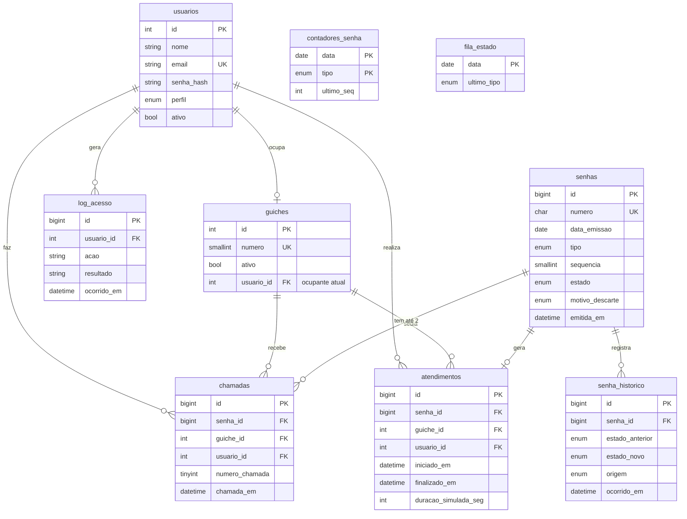

# Modelo de dados (MySQL 8.0)

Convenções: `utf8mb4`, InnoDB, nomes em português sem acento, datas em horário de Recife gravadas pela aplicação (`core/tempo.py`). Valores técnicos dos enums não têm acento (`NAO_COMPARECEU`).

## 1. Diagrama entidade-relacionamento


## 2. Quem usa cada tabela
| Tabela | Finalidade | Dono do SQL |
|---|---|---|
| `usuarios`, `guiches`, `log_acesso` | autenticação, ocupação de guichê, LGPD | Dev B |
| `senhas`, `senha_historico`, `chamadas`, `atendimentos`, `contadores_senha`, `fila_estado` | fila, estados, auditoria | Dev A |
| Relatórios | só leitura de todas as tabelas | Dev B |

## 3. `database/schema/01_base.sql` (Dev B)
Aplicado por `python -m database.migrar` (ou pelo seed): cada `.sql` de `database/schema/` roda uma vez, na ordem, e fica registrado em `schema_migracoes`.
```sql
CREATE TABLE usuarios (
  id          INT UNSIGNED AUTO_INCREMENT PRIMARY KEY,
  nome        VARCHAR(100) NOT NULL,
  email       VARCHAR(150) NOT NULL,
  senha_hash  VARCHAR(255) NOT NULL,
  perfil      ENUM('ATENDENTE','GESTOR') NOT NULL,
  ativo       TINYINT(1) NOT NULL DEFAULT 1,
  criado_em   DATETIME NOT NULL DEFAULT CURRENT_TIMESTAMP,
  -- RN-13: um único GESTOR ativo. Vale 1 só para gestor ativo (senão NULL, que o UNIQUE aceita repetido).
  gestor_ativo TINYINT GENERATED ALWAYS AS (CASE WHEN perfil = 'GESTOR' AND ativo = 1 THEN 1 ELSE NULL END) STORED,
  UNIQUE KEY uq_usuarios_email (email),
  UNIQUE KEY uq_gestor_unico (gestor_ativo)
) ENGINE=InnoDB DEFAULT CHARSET=utf8mb4;

CREATE TABLE guiches (
  id          INT UNSIGNED AUTO_INCREMENT PRIMARY KEY,
  numero      SMALLINT UNSIGNED NOT NULL,
  ativo       TINYINT(1) NOT NULL DEFAULT 1,
  usuario_id  INT UNSIGNED NULL,                -- atendente que ocupa agora
  UNIQUE KEY uq_guiches_numero (numero),
  UNIQUE KEY uq_guiches_usuario (usuario_id),   -- um atendente, um guichê
  CONSTRAINT fk_guiches_usuario FOREIGN KEY (usuario_id) REFERENCES usuarios(id)
) ENGINE=InnoDB DEFAULT CHARSET=utf8mb4;

CREATE TABLE log_acesso (
  id          BIGINT UNSIGNED AUTO_INCREMENT PRIMARY KEY,
  usuario_id  INT UNSIGNED NULL,
  acao        VARCHAR(60) NOT NULL,
  recurso     VARCHAR(150) NULL,
  ip          VARCHAR(45) NULL,
  resultado   ENUM('SUCESSO','NEGADO','FALHA') NOT NULL,
  ocorrido_em DATETIME NOT NULL DEFAULT CURRENT_TIMESTAMP,
  KEY ix_log_usuario_data (usuario_id, ocorrido_em),
  CONSTRAINT fk_log_usuario FOREIGN KEY (usuario_id) REFERENCES usuarios(id)
) ENGINE=InnoDB DEFAULT CHARSET=utf8mb4;
```

## 4. `database/schema/02_fila.sql` (Dev A)
```sql
CREATE TABLE contadores_senha (
  data        DATE NOT NULL,
  tipo        ENUM('SP','SG','SE') NOT NULL,
  ultimo_seq  INT UNSIGNED NOT NULL DEFAULT 0,
  PRIMARY KEY (data, tipo)
) ENGINE=InnoDB DEFAULT CHARSET=utf8mb4;

CREATE TABLE fila_estado (                      -- uma linha por dia; é o "cadeado" da chamada
  data         DATE NOT NULL PRIMARY KEY,
  ultimo_tipo  ENUM('SP','SG','SE') NULL
) ENGINE=InnoDB DEFAULT CHARSET=utf8mb4;

CREATE TABLE senhas (
  id              BIGINT UNSIGNED AUTO_INCREMENT PRIMARY KEY,
  numero          CHAR(12) NOT NULL,            -- YYMMDD-PPSQ
  data_emissao    DATE NOT NULL,
  tipo            ENUM('SP','SG','SE') NOT NULL,
  sequencia       SMALLINT UNSIGNED NOT NULL,
  estado          ENUM('EMITIDA','AGUARDANDO','CHAMADA','CHAMADA_NOVAMENTE',
                       'EM_ATENDIMENTO','ATENDIDA','NAO_COMPARECEU') NOT NULL,
  motivo_descarte ENUM('ABANDONO','FIM_EXPEDIENTE') NULL,
  emitida_em      DATETIME NOT NULL,
  UNIQUE KEY uq_senhas_numero (numero),
  UNIQUE KEY uq_senhas_dia_tipo_seq (data_emissao, tipo, sequencia),
  KEY ix_senhas_fila (data_emissao, estado, tipo, sequencia),
  CONSTRAINT ck_senhas_seq CHECK (sequencia BETWEEN 1 AND 999),
  CONSTRAINT ck_senhas_motivo CHECK (
    (estado = 'NAO_COMPARECEU' AND motivo_descarte IS NOT NULL) OR
    (estado <> 'NAO_COMPARECEU' AND motivo_descarte IS NULL))
) ENGINE=InnoDB DEFAULT CHARSET=utf8mb4;

CREATE TABLE senha_historico (
  id               BIGINT UNSIGNED AUTO_INCREMENT PRIMARY KEY,
  senha_id         BIGINT UNSIGNED NOT NULL,
  estado_anterior  ENUM('EMITIDA','AGUARDANDO','CHAMADA','CHAMADA_NOVAMENTE',
                        'EM_ATENDIMENTO','ATENDIDA','NAO_COMPARECEU') NULL,
  estado_novo      ENUM('EMITIDA','AGUARDANDO','CHAMADA','CHAMADA_NOVAMENTE',
                        'EM_ATENDIMENTO','ATENDIDA','NAO_COMPARECEU') NOT NULL,
  usuario_id       INT UNSIGNED NULL,
  origem           ENUM('TOTEM','ATENDENTE','SISTEMA') NOT NULL,
  ocorrido_em      DATETIME NOT NULL,
  KEY ix_hist_senha (senha_id, ocorrido_em),
  CONSTRAINT fk_hist_senha   FOREIGN KEY (senha_id)   REFERENCES senhas(id),
  CONSTRAINT fk_hist_usuario FOREIGN KEY (usuario_id) REFERENCES usuarios(id)
) ENGINE=InnoDB DEFAULT CHARSET=utf8mb4;

CREATE TABLE chamadas (
  id              BIGINT UNSIGNED AUTO_INCREMENT PRIMARY KEY,
  senha_id        BIGINT UNSIGNED NOT NULL,
  guiche_id       INT UNSIGNED NOT NULL,
  usuario_id      INT UNSIGNED NOT NULL,
  numero_chamada  TINYINT UNSIGNED NOT NULL,    -- 1 ou 2
  chamada_em      DATETIME NOT NULL,
  UNIQUE KEY uq_chamada_senha_num (senha_id, numero_chamada),
  KEY ix_chamadas_recentes (chamada_em),
  CONSTRAINT ck_chamada_num CHECK (numero_chamada IN (1,2)),
  CONSTRAINT fk_chamada_senha   FOREIGN KEY (senha_id)   REFERENCES senhas(id),
  CONSTRAINT fk_chamada_guiche  FOREIGN KEY (guiche_id)  REFERENCES guiches(id),
  CONSTRAINT fk_chamada_usuario FOREIGN KEY (usuario_id) REFERENCES usuarios(id)
) ENGINE=InnoDB DEFAULT CHARSET=utf8mb4;

CREATE TABLE atendimentos (
  id                   BIGINT UNSIGNED AUTO_INCREMENT PRIMARY KEY,
  senha_id             BIGINT UNSIGNED NOT NULL,
  guiche_id            INT UNSIGNED NOT NULL,
  usuario_id           INT UNSIGNED NOT NULL,
  iniciado_em          DATETIME NOT NULL,
  finalizado_em        DATETIME NULL,
  duracao_simulada_seg INT UNSIGNED NOT NULL,   -- TM sorteado (RN-07)
  UNIQUE KEY uq_atend_senha (senha_id),
  CONSTRAINT ck_atend_fim CHECK (finalizado_em IS NULL OR finalizado_em >= iniciado_em),
  CONSTRAINT fk_atend_senha   FOREIGN KEY (senha_id)   REFERENCES senhas(id),
  CONSTRAINT fk_atend_guiche  FOREIGN KEY (guiche_id)  REFERENCES guiches(id),
  CONSTRAINT fk_atend_usuario FOREIGN KEY (usuario_id) REFERENCES usuarios(id)
) ENGINE=InnoDB DEFAULT CHARSET=utf8mb4;
```

## 5. Queries-chave (modelo para o Dev A)
**Próximo número (atômico, sem corrida):**
```sql
INSERT INTO contadores_senha (data, tipo, ultimo_seq) VALUES (%s, %s, LAST_INSERT_ID(1))
ON DUPLICATE KEY UPDATE ultimo_seq = LAST_INSERT_ID(ultimo_seq + 1);
SELECT LAST_INSERT_ID();   -- sequência a usar
```
**Cadeado da fila (início da transação de "chamar próximo"):**
```sql
INSERT INTO fila_estado (data) VALUES (%s) ON DUPLICATE KEY UPDATE data = data;  -- lock exclusivo direto (nao use INSERT IGNORE: deadlock, ver ADR-002)
SELECT ultimo_tipo FROM fila_estado WHERE data = %s FOR UPDATE;
```
**Menor senha aguardando de um tipo:**
```sql
SELECT id, numero, tipo, sequencia FROM senhas
WHERE data_emissao = %s AND estado = 'AGUARDANDO' AND tipo = %s
ORDER BY sequencia LIMIT 1 FOR UPDATE;
```
**Painel (5 últimas senhas chamadas):**
```sql
SELECT s.numero, s.tipo, s.sequencia, g.numero AS guiche, c.numero_chamada, c.chamada_em
FROM chamadas c
JOIN senhas s  ON s.id = c.senha_id
JOIN guiches g ON g.id = c.guiche_id
WHERE c.id IN (SELECT MAX(id) FROM chamadas WHERE DATE(chamada_em) = %s GROUP BY senha_id)
ORDER BY c.chamada_em DESC LIMIT 5;
```

## 6. Seed (`database/seed.py`)
Gera os hashes com argon2 e insere (somente ambiente de desenvolvimento):
| Usuário | E-mail | Senha | Perfil |
|---|---|---|---|
| Gestor | `gestor@nassau.local` | `Gestor@123` | GESTOR |
| Atendente 1 | `atendente1@nassau.local` | `Atendente@123` | ATENDENTE |
| Atendente 2 | `atendente2@nassau.local` | `Atendente@123` | ATENDENTE |

Guichês 1, 2 e 3 ativos e livres. O README deve avisar que essas credenciais são só de teste.
