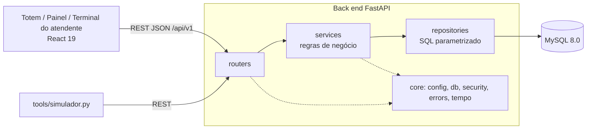
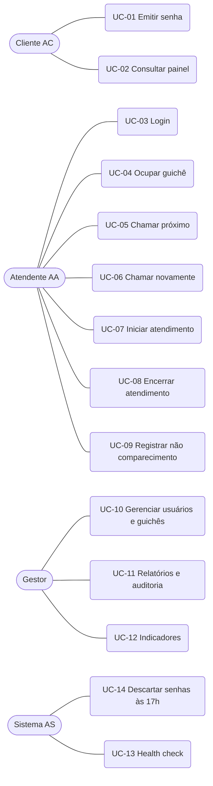
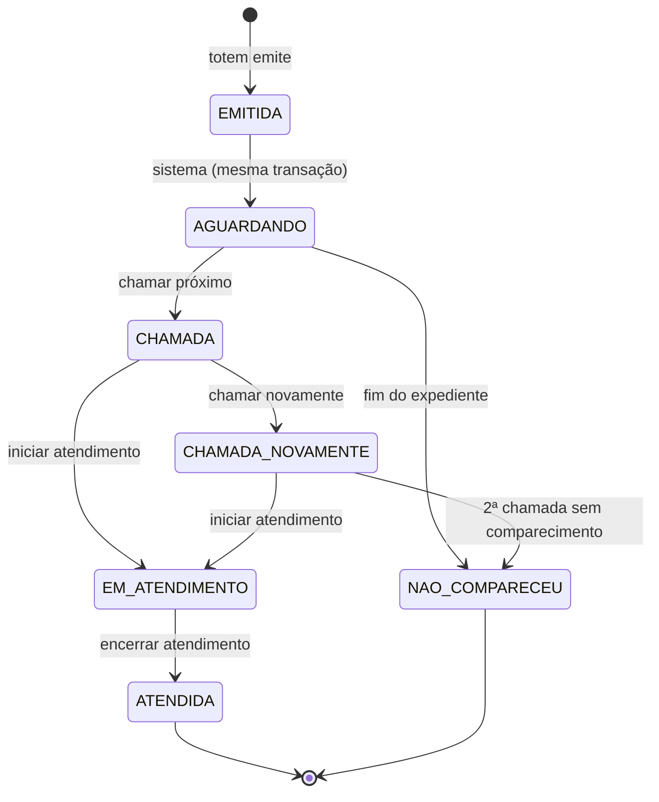
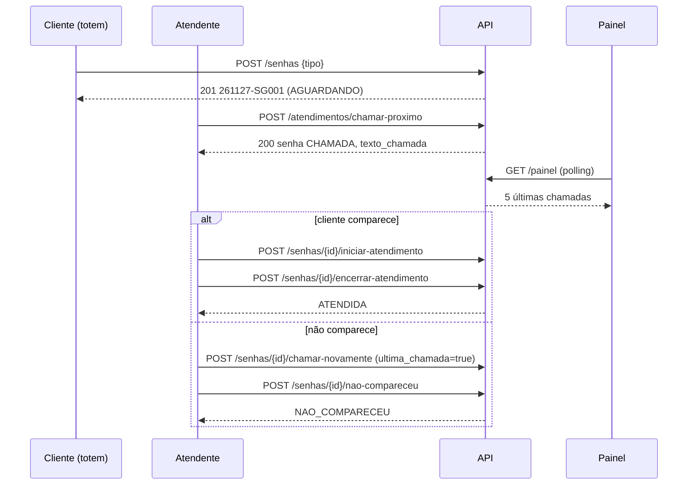

# Diagramas (Mermaid — o GitHub renderiza direto)

## 1. Arquitetura


## 2. Casos de uso

O GESTOR também executa os casos de uso do atendente.

## 3. Máquina de estados da senha

**Tabela de transições (fonte única para o código e os testes):**
| De | Para | Ação | Quem |
|---|---|---|---|
| (nova) | EMITIDA | emitir | TOTEM |
| EMITIDA | AGUARDANDO | concluir emissão | SISTEMA |
| AGUARDANDO | CHAMADA | chamar próximo | ATENDENTE |
| AGUARDANDO | NAO_COMPARECEU (`FIM_EXPEDIENTE`) | descarte às 17h | SISTEMA |
| CHAMADA | CHAMADA_NOVAMENTE | chamar novamente | ATENDENTE |
| CHAMADA | EM_ATENDIMENTO | iniciar | ATENDENTE |
| CHAMADA_NOVAMENTE | EM_ATENDIMENTO | iniciar | ATENDENTE |
| CHAMADA_NOVAMENTE | NAO_COMPARECEU (`ABANDONO`) | não compareceu | ATENDENTE |
| EM_ATENDIMENTO | ATENDIDA | encerrar | ATENDENTE |

Qualquer par fora da tabela → `409 TRANSICAO_INVALIDA`. Toda transição grava uma linha em `senha_historico`.

## 4. Sequência: chamar próximo (concorrência)
```mermaid
sequenceDiagram
    participant A1 as Atendente 1
    participant A2 as Atendente 2
    participant API as API (service fila)
    participant DB as MySQL
    A1->>API: POST /atendimentos/chamar-proximo
    A2->>API: POST /atendimentos/chamar-proximo
    API->>DB: BEGIN; SELECT ultimo_tipo FROM fila_estado FOR UPDATE (A1 obtém o lock)
    Note over API,DB: A2 espera o lock (transação serializada)
    API->>DB: escolher_tipo + SELECT senha aguardando FOR UPDATE
    API->>DB: UPDATE senhas→CHAMADA; INSERT chamadas; INSERT senha_historico; UPDATE fila_estado.ultimo_tipo
    DB-->>API: COMMIT (libera o lock)
    API-->>A1: 200 senha X, guichê 1
    API->>DB: (A2 obtém o lock) escolhe a próxima senha, já sem a X
    DB-->>API: COMMIT
    API-->>A2: 200 senha Y, guichê 2
```

## 5. Sequência: fluxo completo de uma senha

